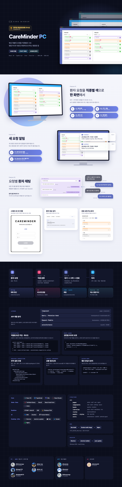

### CareMinder PC — 병동 환자 요청 실시간 관리

병상 태블릿에서 들어온 환자 요청을 **병동 PC와 의료진에게 직종별로 나눠 전달**하는 병원용 PC 애플리케이션입니다. 
병동 · 의료진 · 병원 관리자 권한별 화면을 하나의 React 앱으로 만들고, 웹과 Electron 데스크톱 앱으로 함께 배포했습니다.

CareMinder-Basic 팀 프로젝트 · 2024.06 ~ 2025.03

**개발 기록** — [병원 B2B 서비스 개발기](https://blog.omnipo58-e94.workers.dev/series/hospital-b2b/) 
[Git-flow 도입기](https://blog.omnipo58-e94.workers.dev/posts/thoughts-on-gitflow/) · [3단계 권한 토큰 자동 매핑](https://blog.omnipo58-e94.workers.dev/posts/three-tier-login-roles/) · [Electron 전환과 웹뷰 구조](https://blog.omnipo58-e94.workers.dev/posts/electron-migration/)

